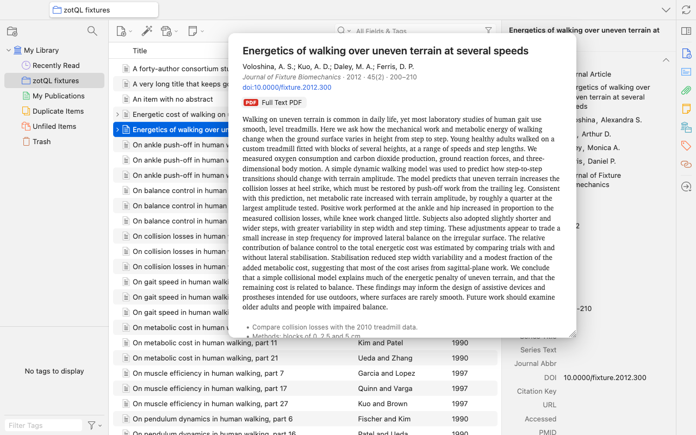
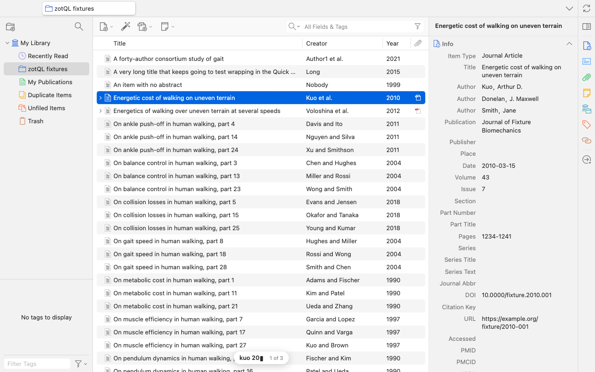
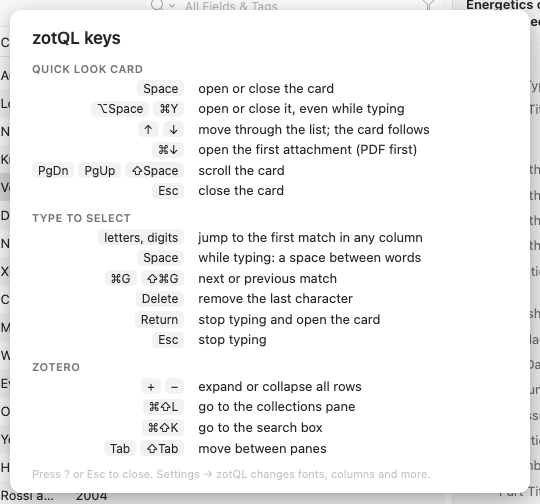
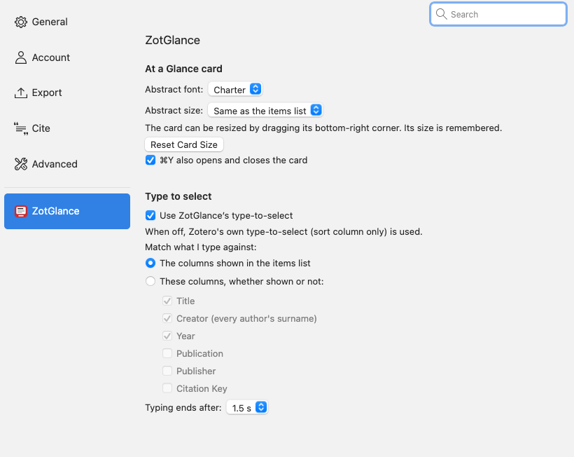

# ZotGlance

A Zotero plugin for keyboard users: press Space for an at-a-glance card of an item's title, authors, journal and abstract, or type to jump to any item.

- **At a Glance:** press **Space** on an item to see its main details in a card over the list, much as Space shows a preview in macOS Finder. Press Space again (or Esc) to close it.
- **Better type-to-select:** start typing to jump to an item. ZotGlance matches every column shown in the list, and every author, not just the column the list is sorted by. Type `smith 2010`, or just `smith2010`, to jump to Smith's 2010 paper.





## At a Glance card

Select an item and press **Space**. The card shows:

- title and authors
- publication, year, volume, issue and pages
- DOI and URL as links
- one button per attachment, PDFs first (so a red PDF button means the item has a PDF)
- the abstract
- the first line of up to three notes

While the card is open:

| Key                        | Does                                                     |
| -------------------------- | -------------------------------------------------------- |
| ↑ / ↓                      | move through the list; the card follows                  |
| Space, Esc, ⌘Y             | close the card                                           |
| ⌘↓                         | open the first attachment (PDF first) and close the card |
| Page Down, Page Up, ⇧Space | scroll the abstract                                      |

**⌥Space** and **⌘Y** also open and close the card. ⌥Space works even while you're typing to select.

On an attachment or a note, the card shows its parent item with that attachment or note highlighted. Clicking another row keeps the card open on that row. Clicking elsewhere, switching collections, or opening a tab closes it.

Drag the card's bottom-right corner to resize it. ZotGlance remembers the size.

## Type-to-select

In the items list, type part of a title, an author's surname, or a year to jump to an item. Zotero's own type-to-select only matches the column the list is sorted by; ZotGlance matches every shown column (you can switch back to Zotero's in Settings). The list jumps to the first match from the selected item, and a small indicator at the bottom shows what you typed and how many items match.

- Words can match in any column and in any order: `walking smith` and `smith walking` both work.
- Each word you type matches the start of a word: `walk` matches "walking", `alk` doesn't.
- Every author counts, not only the first one shown in the Creator column.
- You don't need a space between letters and numbers: `jones2006` finds Jones in Creator and 2006 in Year. ZotGlance tries what you typed as-is first, so `h2o` still finds "H2O".
- **⌘G** and **⇧⌘G** go to the next and previous match.
- While you're typing, Space adds a space. Typing ends 1.5 seconds after your last key (adjustable), and then Space opens the card again.
- Accents don't matter: `muller` finds "Müller".
- Typing starts with a letter or digit. Punctuation typed first doesn't start it: `?` shows the keys, and `+` and `-` still expand and collapse all rows, as in Zotero.

Nothing is hidden or filtered; the selection just moves.

## Keys and help

Press **?** in the items list for a card listing all the keys.



ZotGlance only changes how keys behave while the items list has focus. It doesn't filter or search your library, and it never changes your items.

## Settings

In Zotero's Settings, under **ZotGlance**:



- the abstract's font and size
- Reset Card Size
- whether ⌘Y opens the card
- type-to-select on or off (off brings back Zotero's own, which only matches the sort column)
- which columns type-to-select matches: the ones shown in the list (default), or a fixed set whether shown or not
- how long until typing ends

## Install

Requires **Zotero 10**. Developed and tested on macOS.

1.  Download `zot-glance.xpi` from the [latest release](https://github.com/artkuo/ZotGlance/releases/latest).
2.  In Zotero, open **Tools → Plugins**, click the gear menu, and choose **Install Plugin From File…**.
3.  Pick the downloaded file.

Zotero checks for updates to ZotGlance automatically.

## Compatibility notes

- ZotGlance reads parts of Zotero's items list that aren't public API. A Zotero update could break it; please [open an issue](https://github.com/artkuo/ZotGlance/issues) if it does.
- It takes over Space in the items list. Zotero normally uses Space there to toggle the selection of the focused row (like ⌘-click). Use ⌘-click for that instead.
- Another plugin that also uses Space in the items list would conflict with it.

## Development

Built with [zotero-plugin-template](https://github.com/windingwind/zotero-plugin-template) (TypeScript, esbuild, zotero-plugin-scaffold).

```bash
npm install
npm run build      # .scaffold/build/zot-glance.xpi
npm run test:unit  # pure logic, no Zotero needed
npm run lint:check
```

`npm start` runs a separate development copy of Zotero with hot reload. Copy `.env.example` to `.env` and point it at a **separate** profile and data directory, never your real library. `NOTES.md` records how Zotero 10's internals behave.

## Authors

Art Kuo, with Command Code, which wrote much of the tested core logic.

## License

[AGPL-3.0-or-later](LICENSE).
